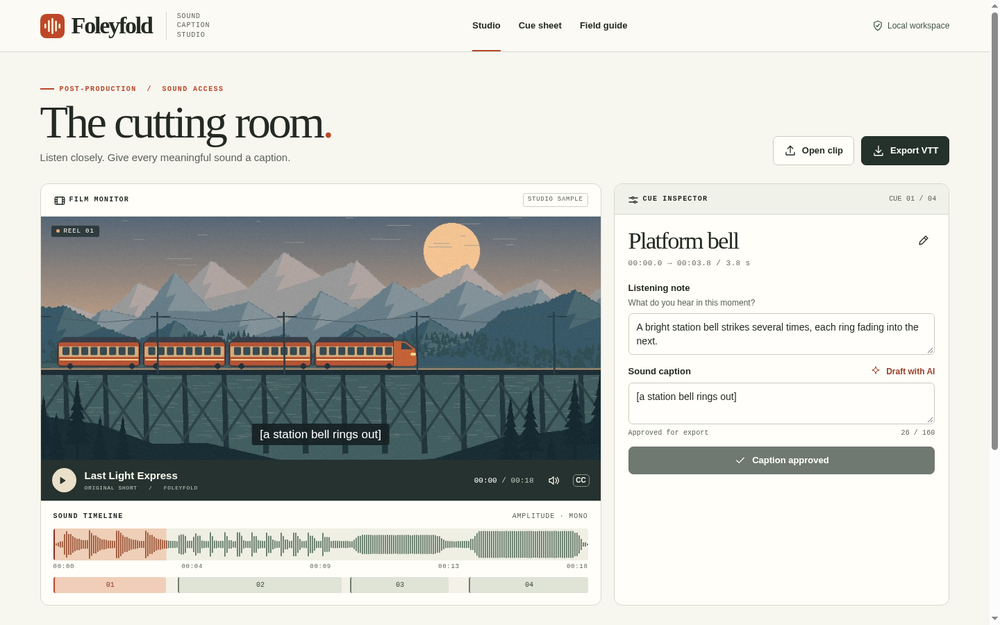

# Foleyfold

**Give the sounds between the words a caption.** A private sound-caption cutting room for independent filmmakers. Listen to the original rail short or open a local cut, spot the sounds that carry the scene, and deliver a human-reviewed WebVTT track. Your film never leaves the browser.



**[Watch the 79-second demo](submission/video/demo.mp4)** · **[See the studio gallery](submission/screenshots/)** · **[Review submission readiness](submission/readiness.md)**

## Try a cut in a minute

Use Node 24 LTS. No signup, Firebase account or GPU is required for the manual studio.

```sh
npm ci
npm run dev
```

1. Open the URL printed by Vite and play **Last Light Express**. The 18-second sample has four authored spots and one approved caption.
2. Select **Passing wheels** to seek to its time range. Listen, then write one line in **Sound caption**. **Draft with AI** is an optional wording aid, not automatic sound detection.
3. **Approve caption**, play it with **CC** enabled, then **Export VTT → Download WebVTT**. Only approved captions are in the file. Editing a line or its timing sends it back to draft.
4. For your own film use **Open clip** and **Add cue**. Cue sheets restore when you reopen the same file in the same browser profile. Media bytes are not saved or uploaded.

A signed-in organization member can [try the preview](https://foleyfold--mlarpbwp.preview.devinapps.com). The public judging deployment is tracked in the [readiness matrix](submission/readiness.md).

## What “hybrid” means here

Only your **listening note and cue duration** enter the prompt. The application calls the official Firebase AI Logic SDK at runtime. By default it requests only the device model; it refuses to send the note if local capability is unknown or unavailable. One explicit, online opt-in permits cloud fallback for that request. App Check attests the configured client. The result label comes from the SDK's reported source, and suggestions require human review. There is no fake response in the unconfigured edition.

Supported route: Chrome desktop with the required built-in model, or an attested online client for cloud inference. Mobile layout does not imply mobile Nano support. The already-open editor can work offline; a fresh offline page load is not guaranteed. See the [verification protocol and evidence limits](docs/hybrid-inference.md).

## Engineering and submission

| Need | Start here |
|---|---|
| Install, configure Firebase or troubleshoot | [Setup](docs/setup.md) |
| Data flow, storage and privacy | [Architecture](docs/architecture.md) |
| Deploy a public, attested build | [Deployment and rollback](docs/deployment.md) |
| Reproduce checks | `npm run lint && npm test && npm run build && npm audit --audit-level=high` |
| Contest research and idea choice | [Rules](research/hackathon-rules.md) · [Competitors](research/competitive-analysis.md) · [Scoring](research/idea-scoring.md) |
| Copy the submission | [Devpost story](submission/devpost.md) · [Fields](submission/submission-fields.md) · [Checklist](submission/requirements-checklist.md) |
| Review or replace the demo | [Director's script and recording guide](submission/video/demo-script.md) · [Shot list](submission/video/storyboard.md) · [Subtitles](submission/video/subtitles.srt) |

TypeScript, Vite, Firebase AI Logic and native browser media APIs. The sample animation, synthesized sounds and illustration were created for this project; the [sample renderer](scripts/render-sample.py) is included. Architecture, code, original artwork and documentation use [Apache-2.0](LICENSE); dependencies retain their own licenses. AI-assisted development is disclosed in the submission.
